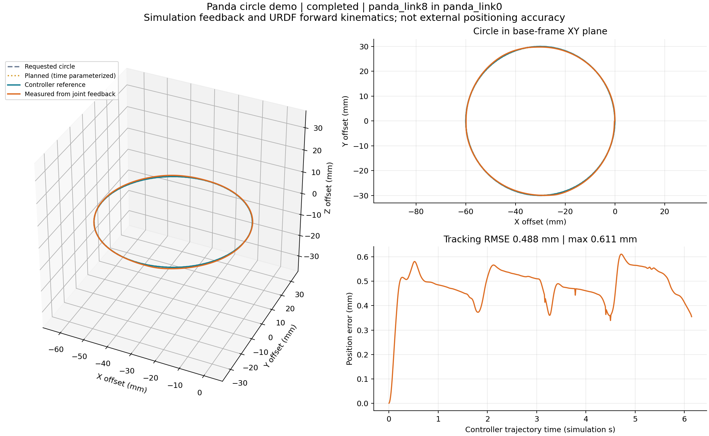
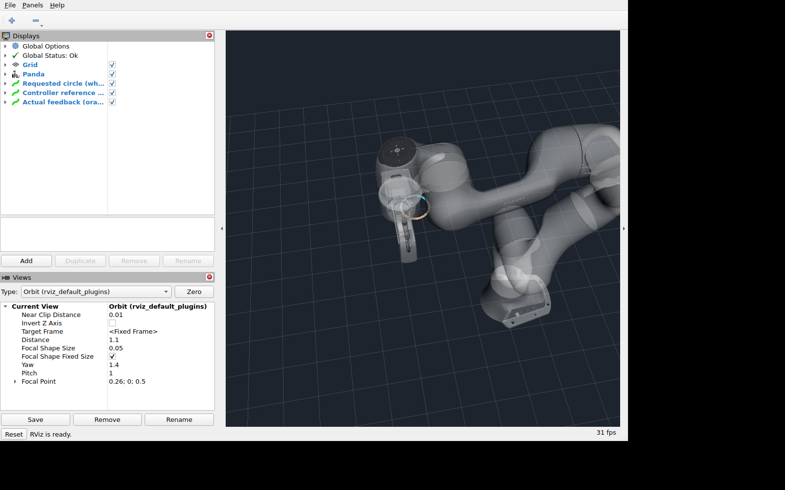

# 学习任务 1：画圆演示验证记录

验证日期：2026-11-06。环境为本项目 Ubuntu 24.04 / ROS 2 Jazzy Docker，
MuJoCo 3.2.0、MoveIt 2.12.4。所有运动发生在仿真中，没有连接真实机器人。

使用方法和学习实验见[画圆教程](../franka_learning_demos/README.md)。
机器可读证据见[验证结果](validation/panda-circle-results.json)。

## 功能检查

| 检查 | 结果 |
|---|---|
| 包构建及 ROS 包索引 | 通过，可由 `ros2 launch franka_learning_demos circle.launch.py` 启动 |
| 坐标变换单元测试 | colcon / pytest：4 项通过，0 失败 |
| 三个配置下的 FK 交叉检查 | 与 MoveIt FK 的矩阵/位置差异小于 1e-6 |
| 默认圆轨迹 | 半径 0.03 m，81 个请求路点，规划完整率 100%，63 个时间参数化轨迹点 |
| MuJoCo 执行 | MoveIt 返回成功，规划时长约 6.152 仿真秒 |
| 同步采集 | 无界面运行 604 个样本，覆盖约 99.91%，最大采样间隔 0.014 仿真秒 |
| 仅规划 | 完整路径，未发送执行请求，没有伪造实际轨迹样本 |
| 工作区被碰撞物占据 | 路径完整率 0，拒绝执行，零运动记录样本 |
| 无效半径 | 参数检查拒绝，未发送执行请求 |
| 非仿真时间 | 入口拒绝，未发送执行请求 |
| 窗口显示 | Xvfb + Mesa 下 MuJoCo 与 RViz 启动，RViz Global Status 为 OK |
| 最新窗口运行关闭 | 演示节点及全部子节点正常退出，无强制终止 |

无界面基准结果：

- 末端位置跟踪 RMSE：约 **0.488 mm**；最大误差约 **0.611 mm**。
- 实际点到请求圆的几何距离 RMSE：约 **0.332 mm**。
- 最大姿态误差：约 **0.02377 rad**（1.36°）。朝向指令固定，不代表实际朝向误差为零。
- 最后一个运动时段样本到目标终点的距离：约 **0.360 mm**；不是静置后的定位精度。

这些指标由控制器同一状态消息中的 reference / feedback 通过 URDF FK 得到，
不代表外部测量的绝对定位精度。当前控制器参数下的跟踪误差是实验结果的一部分。
本验证不覆盖真机、接触任务、长期稳定性或所有可配置轨迹。



RViz 法兰轨迹特写；白色为请求路径、青色为控制器参考、橙色为实际反馈：



## 复现与数据

容器工作区内执行：

```bash
source install/setup.bash
colcon test --packages-select franka_learning_demos
colcon test-result --test-result-base build/franka_learning_demos --verbose
python3 src/tools/verify_circle_demo.py
xvfb-run -a -s '-screen 0 1600x1000x24' env LIBGL_ALWAYS_SOFTWARE=1 \
  python3 src/tools/verify_circle_demo.py --gui --screenshot --circle-only
```

验证脚本在新的输出目录下保存每个场景的日志和 CSV。当前机器的原始结果位于
`.jazzy_validation/circle-regression-3/` 和 `.jazzy_validation/circle-gui-verified/`，
这些完整日志不纳入 Git；摘要和两张展示图随仓库保存。

功能成功和关闭状态分别记录。发行版 `joint_state_publisher` 在部分先前窗口检查的
关闭阶段仍出现过 rclpy 异常，见[既有 Jazzy 记录](jazzy-validation.zh-CN.md#关闭状态与已知问题)。
最新窗口检查全部正常退出，不据此认定发行版偶发关闭异常已被修复。
